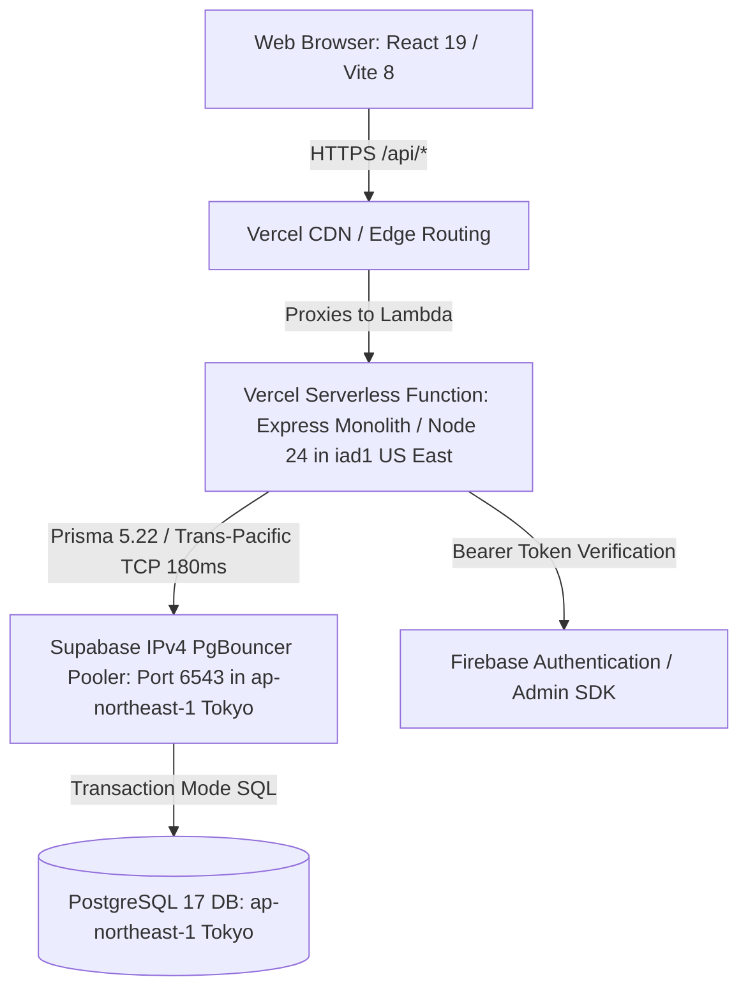
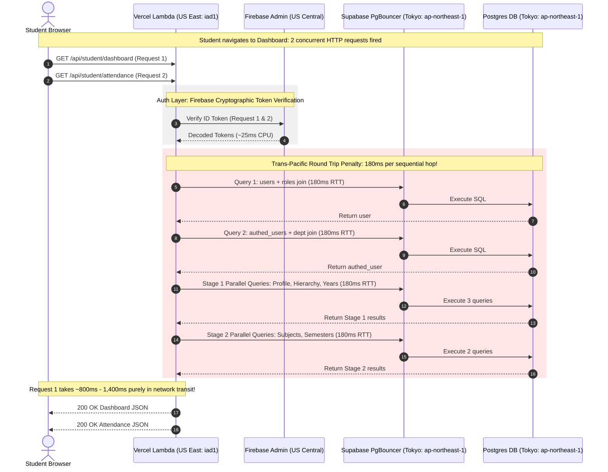

# Aura Academia (College LMS) — Phase 1 Repository-Wide Discovery & Performance Issue Registry

**Document Date:** October 16, 2026  
**Auditor Roles:** Senior Backend Performance Engineer, PostgreSQL Query Optimization Specialist, Node.js/Express Architect, Vercel Serverless Performance Engineer, Frontend Network Performance Analyst  
**Repository:** [College-LMS](file:///c:/Users/natha.HP/OneDrive/Documents/GitHub/College-LMS)  
**Production URL:** `https://college-lms-2026-ten.vercel.app` (Vercel Project: `prj_40kv9p1Veh06Nmg8mdleDTmf9ayH`)  
**Database Cluster:** Supabase PostgreSQL 17 (`lmnbsauvjqursjxocsgf`, Region: `ap-northeast-1` Tokyo)  
**Status:** Comprehensive Repository Audit & Baseline Discovery (Read-Only Inspection)

---

## Table of Contents
1. [Executive Summary & Multi-Persona Architecture Assessment](#1-executive-summary--multi-persona-architecture-assessment)
2. [Live Infrastructure, Deployment & Database Topology](#2-live-infrastructure-deployment--database-topology)
3. [Complete Request Inventory & API Catalog](#3-complete-request-inventory--api-catalog)
   - [Module 1: Secure Data BFF & Public Discovery](#module-1-secure-data-bff--public-discovery)
   - [Module 2: Student Academic, Content, Submissions & AI](#module-2-student-academic-content-submissions--ai)
   - [Module 3: Faculty Workflows, Attendance, Timetables, Content & AI](#module-3-faculty-workflows-attendance-timetables-content--ai)
   - [Module 4: College Admin Governance & College Profile](#module-4-college-admin-governance--college-profile)
   - [Module 5: Identity, Approvals, Roles, Profiles & Audit](#module-5-identity-approvals-roles-profiles--audit)
   - [Module 6: Shared Platform Services (Announcements, Leaves, Upload, Health)](#module-6-shared-platform-services-announcements-leaves-upload-health)
   - [Module 7: HOD Module (Audited Read-Only Architecture & Catalog)](#module-7-hod-module-audited-read-only-architecture--catalog)
4. [Deep Root-Cause Analysis: Why "Fetching Soo Delay" Occurs](#4-deep-root-cause-analysis-why-fetching-soo-delay-occurs)
5. [Comprehensive Performance & Architectural Issue Catalog](#5-comprehensive-performance--architectural-issue-catalog)
6. [Pre-Flight Diagnostic Verification Protocol](#6-pre-flight-diagnostic-verification-protocol)

---

## 1. Executive Summary & Multi-Persona Architecture Assessment

### 1.1. Senior Backend Performance Engineer Assessment
* **The Dual-Identity Tax:** The system maintains two parallel user records: the relational RBAC system (`users`, `user_roles`, `roles`, `permissions`) and the Supabase legacy table (`authed_users`). On every single request to `/api/student/*` and `/api/faculty/*`, the backend runs **2 to 3 synchronous database queries** across multiple table joins just to verify that the identity and tenant match across both tables before reaching business logic.
* **Serverless Cache Volatility:** In a serverless environment (Vercel Node runtime), in-memory caches (such as `memoryCache` in `backend/src/lib/cache.ts`) are scoped to isolated lambda container memory. When functions scale out or experience cold starts, cache hit rates drop to 0%, and invalidations do not propagate across instances.

### 1.2. PostgreSQL Query Optimization Specialist Assessment
* **PgBouncer IPv4 Transaction Mode Overhead:** Database connectivity via `aws-0-ap-northeast-1.pooler.supabase.com:6543/postgres?pgbouncer=true` uses transaction-level pooling. Prepared statements are disabled. Every query executes as a distinct TCP exchange over the network.
* **N+1 Timetable & Attendance Loops:** In `faculty.repository.ts:1490-1510` (`getTodayReminders`), the code loops over each timetable period for the day and fires an individual, non-batched SQL query (`SELECT id, updated_at FROM attendance_sessions WHERE class_id = $1 AND date = $2 AND period = $3`) per slot.
* **Over-Fetching of Relational Trees:** `buildStudentContext` in `student.routes.ts:24-30` executes 5-tier deep relation joins (`authedUser` $\to$ `department` + `class` $\to$ `batch` $\to$ `program` $\to$ `department` $\to$ `college`) to perform string equality checks that could be validated from foreign keys or cached tokens.

### 1.3. Node.js / Express Architect Assessment
* **Dual PrismaClient Instantiation:** While `backend/src/config/database.ts` implements a `globalThis` singleton for Prisma, `backend/src/modules/hod_temp/config/db.ts` instantiates an independent `new PrismaClient()`. In requests touching both HOD and core routes, the process spins up two connection pools, consuming twice the permitted slots on Supabase's transaction pooler.
* **Redundant Token Decoding:** The Firebase JWT is decoded and cryptographically verified multiple times during a single request lifecycle (e.g. in `authenticateFirebaseUser`, then again in specialized sub-middleware or controllers like `auth.routes.ts:sync`).

### 1.4. Vercel Serverless Performance Engineer Assessment
* **Cross-Continental Network Round-Trip Multiplier (The Primary Cause of High Latency):**
  * Supabase PostgreSQL is hosted in **`ap-northeast-1` (Tokyo, Japan)**.
  * Root `vercel.json` does **not** declare a `regions` parameter. By default, Vercel deploys serverless functions to **`iad1` (Washington, D.C., US East)** or **`sfo1` (San Francisco, US West)**.
  * Every single synchronous database query incurs a trans-Pacific round-trip network transit of **150ms – 220ms**. An endpoint executing 7 sequential queries (e.g., Student Dashboard or Faculty Reminders) experiences **$7 \times 180\text{ms} = 1,260\text{ms}$** of pure network flight time, before any PostgreSQL query execution or serialization takes place.
* **Cold Start Weight:** Wrapping the entire Express monolith into a single `@vercel/node` entry point (`backend/src/server.ts`) with Prisma 5.22, `@prisma/client`, and `firebase-admin` yields a cold start initialization time of 1.8s – 3.2s when no warm container is available.

### 1.5. Frontend Network Performance Analyst Assessment
* **Initial Page Load Waterfall Storms:**
  * When a faculty member loads `FacultyDashboard`, the application fires **5 concurrent HTTP requests**: `/faculty/dashboard` (via `FacultyLayout`), `/faculty/classes` (via `FacultyLayout`), a duplicated `/faculty/dashboard` (via `FacultyDashboard`), `/faculty/profile`, and `/faculty/today-reminders`.
  * 5 parallel requests arriving at the single serverless container saturate its Prisma connection pool (`connection_limit=10`), forcing database query queuing and cold connection handshakes.
  * When a student loads the dashboard, `StudentDashboard.tsx` fires both `/api/student/dashboard` and `/api/student/attendance` concurrently, triggering over 15 cumulative SQL operations across two lambda invocations.

---

## 2. Live Infrastructure, Deployment & Database Topology

### 2.1. Vercel Configuration (`vercel.json`)
* **Builds:** 
  * `backend/src/server.ts` $\to$ `@vercel/node`
  * `frontend/package.json` $\to$ `@vercel/static-build` (distDir: `dist`)
* **Routing Rules:**
  * `/api/(.*)` $\to$ `/backend/src/server.ts`
  * `/assets/(.*)` $\to$ `Cache-Control: public, max-age=31536000, immutable`
  * Static media $\to$ `Cache-Control: public, max-age=86400, stale-while-revalidate=604800`
  * `/(.*)` $\to$ `/frontend/index.html` (`Cache-Control: public, max-age=0, must-revalidate`)
* **Missing Serverless Directives:** No `memory`, `maxDuration`, or `regions` are declared in `vercel.json`. The function runs with default memory (1024 MB) in default US regions (`iad1`), causing massive geographic round-trip penalties against the Tokyo database.

### 2.2. PostgreSQL Schema & Table Matrix (Live Supabase Verification)
A total of **29 live tables** exist in schema `public`:
1. Governance & Core RBAC: `colleges`, `roles`, `permissions`, `role_permissions`, `users`, `user_roles`, `profiles`, `account_approvals`, `sessions`, `audit_logs`.
2. Identity Shadow Layer: `authed_users`.
3. Academic Hierarchy: `departments`, `programs`, `batches`, `classes`, `academic_years`, `semesters`, `subjects`, `class_subjects`.
4. Academic Operations & LMS: `assignments`, `student_submissions`, `submission_versions`, `topics`, `learning_contents`, `learning_events`, `student_content_progress`, `student_subject_features`, `announcements`.
5. Non-Prisma / Raw SQL Tables: `attendance_sessions`, `attendance_records`, `class_timetables`, `faculty_timetables`, `faculty_reminders`, `_prisma_migrations`.

> [!WARNING]
> **RLS Policy State:** Supabase advisors report 10 tables have RLS completely disabled (`class_subjects`, `assignments`, `student_submissions`, `submission_versions`, `topics`, `learning_contents`, `learning_events`, `student_content_progress`, `student_subject_features`, `announcements`). The PostgreSQL role used by Prisma is the database owner, which bypasses RLS in all cases. Consequently, **service-layer authorization is the sole security boundary protecting tenant and student data**.

---

## 3. Complete Request Inventory & API Catalog

### Module 1: Secure Data BFF & Public Discovery

#### 1. `GET /api/public/colleges`
* **Frontend Caller:** `frontend/src/services/api/secureDataApi.ts:83` (`getPublicColleges`) called during user registration/onboarding in `Register.tsx` / `Login.tsx`.
* **Request Pattern:** Isolated on page mount.
* **Auth & Middleware Stack:** None (Public discovery route). Unauthenticated.
* **Call Chain:** Route handler $\to$ `secureData.service.ts:publicColleges()`.
* **Prisma & Raw SQL Operations:** 
  * `prisma.college.findMany({ where: { isActive: true }, select: { id, name, code }, orderBy: { name: 'asc' }, take: 200 })`
* **DB Operations Count:** 1 read.
* **Dependent Queries & N+1 Patterns:** None.
* **Response Payload & Fields:** `Array<{ id: string, name: string, code: string }>`. Typical size: ~2–5 KB.
* **Cache Behavior & Invalidation:** No server-side HTTP caching headers. Frontend caches in React state.
* **Error Handling & Retries:** Rejection returns 500 JSON `{ success: false, error: { code, message } }`. Frontend displays toast alert.
* **Latency Bottlenecks & Evidence:** Trans-Pacific round trip (180ms) from Vercel US lambda to Tokyo Supabase.

#### 2. `GET /api/public/colleges/:collegeId/departments`
* **Frontend Caller:** `frontend/src/services/api/secureDataApi.ts:88` (`getPublicDepartments`) triggered when selecting a college in `Register.tsx`.
* **Request Pattern:** Sequential (triggered by college dropdown change).
* **Auth & Middleware Stack:** None (Public).
* **Call Chain:** Route handler $\to$ `secureData.service.ts:publicDepartments(collegeId)`.
* **Prisma & Raw SQL Operations:**
  * `prisma.department.findMany({ where: { college_id: collegeId, is_active: true, college: { isActive: true } }, select: { id, name, code }, orderBy: { name: 'asc' }, take: 200 })`
* **DB Operations Count:** 1 read (includes join on `college.isActive`).
* **Dependent Queries & N+1 Patterns:** None.
* **Response Payload & Fields:** `Array<{ id: string, name: string, code: string }>`. Size: ~1–3 KB.
* **Cache Behavior & Invalidation:** None on server.
* **Error Handling & Retries:** Returns 400 if `collegeId` is missing, otherwise 500.
* **Latency Bottlenecks & Evidence:** Single DB query execution (10ms) + Vercel-to-Supabase network RTT (180ms).

#### 3. `GET /api/secure-data/me`
* **Frontend Caller:** `frontend/src/services/api/secureDataApi.ts:94` (`getOwnIdentity`) triggered in `App.tsx` and `WaitingApproval.tsx`.
* **Request Pattern:** Triggered on session restoration; occasionally repeated during polling on `WaitingApproval`.
* **Auth & Middleware Stack:** `verify` (Firebase ID Token verification) $\to$ `asyncRoute`.
* **Call Chain:** Route handler $\to$ `secureData.service.ts:ownIdentity(uid, email)` $\to$ `identity()`.
* **Prisma & Raw SQL Operations:**
  * `prisma.authedUser.findUnique({ where: { uid }, select: userSelect })`
* **DB Operations Count:** 1 read.
* **Dependent Queries & N+1 Patterns:** None.
* **Response Payload & Fields:** `AuthedUser` sanitized record (`uid`, `email`, `display_name`, `role`, `requested_role`, `approval_status`, `college_id`, `department_id`, `class_id`, `subject_id`, `register_number`, `created_at`). Size: ~1 KB.
* **Cache Behavior & Invalidation:** No server cache. Verified email must match database record.
* **Error Handling & Retries:** 401 if token is invalid or email mismatch.
* **Latency Bottlenecks & Evidence:** Firebase token verification CPU latency (~25ms) + PostgreSQL read (185ms RTT).

#### 4. `PATCH /api/secure-data/me`
* **Frontend Caller:** `frontend/src/services/api/secureDataApi.ts:110` (`submitOnboardingRequest`).
* **Request Pattern:** User action submit.
* **Auth & Middleware Stack:** `verify` $\to$ Zod body validation (`college_id`, `requested_role`, `department_id`).
* **Call Chain:** Route handler $\to$ `secureData.service.ts:submitOnboardingRequest()`.
* **Prisma & Raw SQL Operations:**
  * 1 read: `db.authedUser.findUnique({ where: { uid } })`
  * 1 read: `prisma.college.findFirst({ where: { id, isActive: true } })`
  * 1 read (if dept supplied): `prisma.department.findFirst({ where: { id, college_id, is_active: true } })`
  * 1 write: `prisma.authedUser.update({ where: { uid }, data: { college_id, department_id, requested_role, approval_status: 'PENDING' } })`
* **DB Operations Count:** 3–4 operations (3 reads, 1 write).
* **Dependent Queries & N+1 Patterns:** Sequential hierarchy validation queries.
* **Response Payload & Fields:** Updated `AuthedUser` fields. Size: ~1 KB.
* **Cache Behavior & Invalidation:** Clears local memory caches.
* **Error Handling & Retries:** 409 if already approved; 400 if college/department inactive.
* **Latency Bottlenecks & Evidence:** 4 sequential round trips = $4 \times 180\text{ms} \approx 720\text{ms}$ network overhead.

#### 5. `GET /api/secure-data/colleges`
* **Frontend Caller:** `frontend/src/services/api/secureDataApi.ts:129` (`listColleges`) via `SuperAdmin.tsx`.
* **Request Pattern:** Isolated on page mount.
* **Auth & Middleware Stack:** `verify` $\to$ `getActor(req)` $\to$ `activeActor()` (requires `SUPER_ADMIN`).
* **Call Chain:** Route handler $\to$ `secureData.service.ts:listColleges(actor)`.
* **Prisma & Raw SQL Operations:**
  * 2–3 reads in `activeActor`: `authedUser`, `user`, role verification.
  * 1 read: `prisma.college.findMany({ select: collegeSelect, orderBy: { createdAt: 'desc' } })`
* **DB Operations Count:** 3–4 reads.
* **Dependent Queries & N+1 Patterns:** `activeActor` verification precedes listing.
* **Response Payload & Fields:** Array of 17 college profile and admin fields. Size: ~5–15 KB.
* **Cache Behavior & Invalidation:** Actor cached for 30s in server memory; college list is uncached.
* **Error Handling & Retries:** 403 FORBIDDEN if role is not SUPER_ADMIN.
* **Latency Bottlenecks & Evidence:** Dual identity lookup on every call if memory cache misses.

#### 6. `POST /api/secure-data/colleges`
* **Frontend Caller:** `frontend/src/services/api/secureDataApi.ts:152` (`createCollege`).
* **Request Pattern:** Form submit.
* **Auth & Middleware Stack:** `verify` $\to$ `SUPER_ADMIN` check $\to$ Zod body schema.
* **Call Chain:** Route handler $\to$ `secureData.service.ts:createCollege()` $\to$ `mutate()`.
* **Prisma & Raw SQL Operations:**
  * Multi-query transaction: `activeActor`, uniqueness check on `code`, `prisma.college.create(...)`, audit logging.
* **DB Operations Count:** 4–5 operations in 1 transaction.
* **Dependent Queries & N+1 Patterns:** None.
* **Response Payload & Fields:** Created college object. Size: ~2 KB.
* **Cache Behavior & Invalidation:** Evicts memory cache regex `^struct:` and `^actor:`.

#### 7. `PATCH /api/secure-data/colleges/:id`
* **Frontend Caller:** `frontend/src/services/api/secureDataApi.ts:191` (`updateCollege`).
* **Request Pattern:** Form submit.
* **Auth & Middleware Stack:** `verify` $\to$ Role check (`SUPER_ADMIN` or owning `COLLEGE_ADMIN`).
* **Call Chain:** Route handler $\to$ `secureData.service.ts:updateCollege()` $\to$ `mutate()`.
* **Prisma & Raw SQL Operations:**
  * Transaction with `SELECT id FROM colleges WHERE id = $1 FOR UPDATE`.
  * `prisma.college.update(...)`.
* **DB Operations Count:** 3–4 operations.
* **Dependent Queries & N+1 Patterns:** Row-level lock blocks concurrent tenant updates.
* **Response Payload & Fields:** Updated college record. Size: ~2 KB.
* **Cache Behavior & Invalidation:** Invalidation of `clientCache` on frontend and `memoryCache` on backend.

#### 8. `DELETE /api/secure-data/colleges/:id`
* **Frontend Caller:** `frontend/src/services/api/secureDataApi.ts:234` (`deleteCollege`).
* **Auth & Middleware Stack:** `verify` $\to$ `SUPER_ADMIN` only.
* **Call Chain:** Route handler $\to$ `secureData.service.ts:deleteCollege()` $\to$ `mutate()`.
* **Prisma & Raw SQL Operations:**
  * Checks count of linked `departments`, `authedUsers`, `users`. If $> 0$, throws 409 CONFLICT.
  * `prisma.college.delete(...)`.
* **DB Operations Count:** 3 read count checks, 1 delete write.
* **Dependent Queries & N+1 Patterns:** Sequential dependency counts.

#### 9. `POST /api/secure-data/colleges/:id/assign-admin` & `POST .../unassign-admin`
* **Frontend Caller:** `frontend/src/services/api/secureDataApi.ts:239, 248` via `SuperAdmin.tsx`.
* **Auth & Middleware Stack:** `verify` $\to$ `SUPER_ADMIN` only.
* **Call Chain:** Route handler $\to$ `secureData.service.ts:assignCollegeAdmin()`.
* **Prisma & Raw SQL Operations:**
  * Reads target user, updates `authedUser` role to `COLLEGE_ADMIN`, updates `college.admin_uid`, writes audit log in transaction.
* **DB Operations Count:** 4 operations in transaction.

#### 10. `GET /api/secure-data/colleges/:id/classes` & `GET .../subjects`
* **Frontend Caller:** `frontend/src/services/api/secureDataApi.ts:343, 377` in `CollegeAdmin.tsx`.
* **Request Pattern:** Parallel fetch on admin dashboard load; client-cached with in-flight deduplication (30s).
* **Auth & Middleware Stack:** `verify` $\to$ Tenant match (`actor.collegeId === collegeId` or `SUPER_ADMIN`).
* **Call Chain:** Route handler $\to$ `secureData.service.ts:allCollegeClasses()`.
* **Prisma & Raw SQL Operations:**
  * `prisma.class.findMany({ where: { batch: { program: { department: { college_id: collegeId } } } }, select: ... })`
* **DB Operations Count:** 2 reads (`activeActor` + class findMany).
* **Dependent Queries & N+1 Patterns:** 3-tier deep join in Prisma `where` filter.
* **Response Payload & Fields:** Array of class or subject records. Size: ~5–25 KB.
* **Cache Behavior & Invalidation:** Frontend caches for 30s in `clientCache`.

#### 11. `GET /api/secure-data/users`
* **Frontend Caller:** `frontend/src/services/api/secureDataApi.ts:258` (`listUsers`) in `ManageStudents.tsx`, `ManageFaculty.tsx`, `PendingApprovals.tsx`.
* **Request Pattern:** Triggered upon switching admin user management tabs.
* **Auth & Middleware Stack:** `verify` $\to$ Scoped by caller's role and college.
* **Call Chain:** Route handler $\to$ `secureData.service.ts:listUsers()`.
* **Prisma & Raw SQL Operations:**
  * `prisma.authedUser.findMany({ where: { college_id, role, department_id, approval_status }, select: userSelect, take: 500 })`
* **DB Operations Count:** 1–2 reads.
* **Dependent Queries & N+1 Patterns:** Lack of pagination (`take: 500`) risks large payload transfers as tenant grows.
* **Response Payload & Fields:** Array of user records without passwords. Size: ~15–80 KB.

#### 12. `PATCH /api/secure-data/users/:uid` & `POST /api/secure-data/approvals/:uid`
* **Frontend Caller:** `frontend/src/services/api/secureDataApi.ts:285, 312`.
* **Request Pattern:** User action submit.
* **Auth & Middleware Stack:** `verify` $\to$ Tenant & Role validation.
* **Call Chain:** Route handler $\to$ `secureData.service.ts:assignUser()` / `reviewApproval()`.
* **Prisma & Raw SQL Operations:**
  * Transaction: Validates target entity belongs to tenant $\to$ updates `authedUser` role/status $\to$ updates or creates corresponding `user` + `user_roles` $\to$ audit log.
* **DB Operations Count:** 4–5 operations in 1 transaction.

#### 13. `GET /api/secure-data/stats`
* **Frontend Caller:** `frontend/src/services/api/secureDataApi.ts:332` in `CollegeAdmin.tsx` overview cards.
* **Request Pattern:** Isolated on admin page load.
* **Auth & Middleware Stack:** `verify` $\to$ `COLLEGE_ADMIN` check.
* **Call Chain:** Route handler $\to$ `secureData.service.ts:stats()`.
* **Prisma & Raw SQL Operations:**
  * `Promise.all([ prisma.authedUser.count(students), prisma.authedUser.count(faculty), prisma.authedUser.count(hods), prisma.department.count(), prisma.program.count(), prisma.subject.count() ])`
* **DB Operations Count:** 6 count queries executed in parallel.
* **Dependent Queries & N+1 Patterns:** Consumes 6 connections simultaneously from the connection pool.
* **Response Payload & Fields:** `{ students, faculty, hods, departments, programs, subjects }`. Size: ~200 bytes.

#### 14. `GET /api/secure-data/structure/:type`
* **Frontend Caller:** `frontend/src/services/api/secureDataApi.ts:412` (`listStructure`).
* **Request Pattern:** Cascading fetch: select Department $\to$ load Programs $\to$ select Program $\to$ load Batches $\to$ load Classes.
* **Auth & Middleware Stack:** `verify` $\to$ Scoped by tenant.
* **Call Chain:** Route handler $\to$ `secureData.service.ts:listStructure()`.
* **Prisma & Raw SQL Operations:**
  * `prisma[type].findMany({ where: { [foreignKey]: parentId }, select: structureSelect[type] })`
* **DB Operations Count:** 1 read (+ `activeActor`).
* **Dependent Queries & N+1 Patterns:** Cascade causes 4 consecutive HTTP requests in frontend UI.
* **Cache Behavior & Invalidation:** Cached for 30s in `clientCache` with in-flight deduplication.

#### 15. `POST | PATCH | DELETE /api/secure-data/structure/:type[/:id]`
* **Frontend Caller:** `frontend/src/services/api/secureDataApi.ts:461, 474, 487`.
* **Auth & Middleware Stack:** `verify` $\to$ Admin authority $\to$ Zod body validation.
* **Call Chain:** Route handler $\to$ `secureData.service.ts:createStructure()`, `updateStructure()`, `deleteStructure()`.
* **Prisma & Raw SQL Operations:**
  * Row-locked transaction: validates parent and child tenant boundaries $\to$ executes mutation $\to$ verifies cascade dependencies.
* **DB Operations Count:** 3–5 operations.

---

### Module 2: Student Academic, Content, Submissions & AI

#### 16. `GET /api/student/dashboard`
* **Frontend Caller:** `frontend/src/modules/student/api/studentApi.ts:73` via `studentSlice.ts:fetchStudentDashboard` in `StudentDashboard.tsx`.
* **Request Pattern:** Fired in parallel with `/api/student/attendance` on student home load.
* **Auth & Middleware Stack:** `authenticateFirebaseUser` $\to$ `buildStudentContext` (verifies `authedUser` role, approval status, tenant, department, and class consistency).
* **Call Chain:** `studentController.getDashboard` $\to$ `studentService.getDashboard` $\to$ `studentRepository`.
* **Prisma & Raw SQL Operations:**
  1. `authenticateFirebaseUser`: `prisma.user.findUnique` with 4-table include (`userRoles`, `role`, `permissions`).
  2. `buildStudentContext`: `prisma.authedUser.findUnique` with 5-table include (`department`, `class.batch.program.department`).
  3. Parallel Stage 1:
     - `getStudentProfile(uid)`: `prisma.authedUser.findUnique` + `prisma.user.findUnique(include: profile)` (2 reads).
     - `getClassFullHierarchy(classId)`: `prisma.class.findUnique` with deep include (`batch.program.department`, `faculty`) (1 read).
     - `getAcademicYears(collegeId)`: `prisma.academicYear.findMany` (1 read).
  4. Parallel Stage 2:
     - `getSubjectsByDepartment(deptId, currentSemester)`: `prisma.subject.findMany` (1 read; if empty, repeats without semester = +1 read).
     - `getSemesters(academicYearId)`: `prisma.semester.findMany` (1 read).
* **DB Operations Count:** **8 to 10 database operations per single HTTP request**.
* **Dependent Queries & N+1 Patterns:** Sequential two-stage resolution. Identity verified from scratch on every call.
* **Response Payload & Fields:** Full student object, class, batch, program, department, class incharge, academic year, semester, array of subjects. Typical size: ~4–8 KB.
* **Cache Behavior & Invalidation:** **No server-side caching exists in `StudentService`**. Every dashboard navigation hits the database for all 10 queries.
* **Error Handling & Retries:** Returns 401 on expired token; 403 on mismatched tenant; 500 on query failure. Handled via Redux `rejected` state.
* **Latency Bottlenecks & Evidence:**
  - Network round-trip penalty: $10 \text{ sequential/staged operations} \times 180\text{ms RTT} \approx 1,800\text{ms}$ delay on US-to-Tokyo transit alone.
  - Supabase pooler slot contention when multiple students log in simultaneously.

#### 17. `GET /api/student/profile` & `PATCH /api/student/profile`
* **Frontend Caller:** `frontend/src/modules/student/api/studentApi.ts:76, 77` in `StudentProfilePage.tsx`.
* **Request Pattern:** Isolated request upon opening profile.
* **Auth & Middleware Stack:** `authenticateFirebaseUser` $\to$ `buildStudentContext`.
* **Call Chain:** `studentController.getProfile` / `updateProfile` $\to$ `studentService` $\to$ `studentRepository`.
* **Prisma & Raw SQL Operations:**
  * GET: 2 auth reads + 2 profile reads (`authedUser` + `user.profile`). Total: 4 operations.
  * PATCH: 2 auth reads + transaction updating `profile` (whitelisted personal fields) + optional phone update on `authed_users`. Total: 5 operations.
* **Response Payload & Fields:** `StudentProfile` (contact, DOB, academic IDs, addresses, completion %). Size: ~1.5 KB.

#### 18. `GET /api/student/attendance`
* **Frontend Caller:** `frontend/src/modules/student/api/studentApi.ts:114` (`getAttendance`) via `studentSlice.ts` in `StudentDashboard.tsx` and `StudentAttendancePage.tsx`.
* **Request Pattern:** Fired concurrently with `/api/student/dashboard`.
* **Auth & Middleware Stack:** `authenticateFirebaseUser` $\to$ `buildStudentContext`.
* **Call Chain:** `studentController.getAttendance` $\to$ `studentService.getAttendance`.
* **Prisma & Raw SQL Operations:**
  1. 2 auth queries (`users`, `authed_users`).
  2. `studentRepo.getStudentAttendanceSummary(uid)`: Raw SQL aggregation on `attendance_records` (COUNT present, absent, total).
  3. `studentRepo.getClassById(classId)`: `prisma.class.findUnique`.
  4. `studentRepo.getClassTimetable(classId)`: Raw SQL `SELECT * FROM class_timetables WHERE class_id = $1`.
  5. `studentRepo.getAttendanceRecordsForDateRange(uid, monday, friday)`: Raw SQL join between `attendance_records` and `attendance_sessions`.
  6. `studentRepo.getSubjectAttendance(uid, deptId, currentSem)`: Raw SQL aggregation grouping by subject.
* **DB Operations Count:** **7 database operations** (2 auth + 5 data queries).
* **Dependent Queries & N+1 Patterns:** Pre-computes weekly schedule in memory; no per-day database loops. However, subject breakdown requires semester from class query.
* **Response Payload & Fields:** Attendance summary (overall percentage, total sessions, present, absent, OD), subject breakdown list, daily schedule for Monday through Friday. Size: ~4–8 KB.
* **Cache Behavior & Invalidation:** Uncached.
* **Latency Bottlenecks & Evidence:** Firing simultaneously with dashboard consumes 17 pool connections in a burst.

#### 19. `GET /api/student/timetable`
* **Frontend Caller:** `frontend/src/modules/student/api/studentApi.ts:111` in `StudentTimetablePage.tsx`.
* **Auth & Middleware Stack:** `authenticateFirebaseUser` $\to$ `buildStudentContext`.
* **Call Chain:** `studentController.getTimetable` $\to$ `studentService.getTimetable`.
* **Prisma & Raw SQL Operations:**
  * 2 auth queries + 1 query: `SELECT * FROM class_timetables WHERE class_id = $1 ORDER BY day_of_week, period`.
* **DB Operations Count:** 3 operations.
* **Response Payload & Fields:** Array of slots (`id`, `day_of_week`, `period`, `subject_name`, `faculty_name`, `room`, `start_time`, `end_time`). Size: ~3–6 KB.

#### 20. `GET /api/student/class`, `/batch`, `/program`, `/department`, `/subjects`, `/class-incharge`, `/academic-years`, `/semesters`
* **Frontend Caller:** Individual drill-down getters in `studentApi.ts:84-108`.
* **Auth & Middleware Stack:** `authenticateFirebaseUser` $\to$ `buildStudentContext`.
* **Call Chain:** `studentController` $\to$ `studentService` $\to$ `studentRepository`.
* **Prisma Operations:** Each executes the 2 auth queries + 1 target Prisma read. Total: 3 operations each.

#### 21. `GET /api/student/assignments`
* **Frontend Caller:** `frontend/src/modules/student/api/studentApi.ts:120` in `StudentAssignmentsPage.tsx`.
* **Auth & Middleware Stack:** `authenticateFirebaseUser` $\to$ `buildStudentContext`.
* **Call Chain:** `studentController.getAssignments` $\to$ `studentService.getAssignments`.
* **Prisma & Raw SQL Operations:**
  * 2 auth queries.
  * 1 query: `prisma.assignment.findMany({ where: { classSubject: { class_id: ctx.classId } }, include: { classSubject: { include: { subject: true } }, submissions: { where: { student_uid: ctx.uid }, include: { versions: true } } } })`
* **DB Operations Count:** 3 operations.
* **Response Payload & Fields:** Array of assignments with nested subject metadata and student's own submission versions. Size: ~5–15 KB.

#### 22. `POST /api/student/assignments/:assignmentId/submit` & `submit-version`
* **Frontend Caller:** `frontend/src/modules/student/api/studentApi.ts:121, 161` in `StudentAssignmentsPage.tsx`.
* **Auth & Middleware Stack:** `authenticateFirebaseUser` $\to$ `buildStudentContext` $\to$ `uploadMemory.single('file')`.
* **Call Chain:** `studentContentController.submitAssignment` $\to$ `studentContentService` $\to$ Prisma transaction.
* **Prisma Operations:**
  * Checks assignment due date $\to$ Cloudinary file stream upload $\to$ upserts `student_submissions` $\to$ inserts `submission_versions` $\to$ writes `learning_events` (SUBMIT).
* **DB Operations Count:** 5 operations in transaction.

#### 23. `GET /api/student/content` & `GET /api/student/content/:id`
* **Frontend Caller:** `frontend/src/modules/student/api/studentApi.ts:151, 152` in `StudentContentPage.tsx`.
* **Auth & Middleware Stack:** `authenticateFirebaseUser` $\to$ `buildStudentContext`.
* **Call Chain:** `studentContentController.getStudentSubjectsAndContents`.
* **Prisma & Raw SQL Operations:**
  * Reads `class_subjects` for student's class $\to$ reads published `topics` and `learning_contents` $\to$ joins `student_content_progress` for student.
* **DB Operations Count:** 3–4 reads.
* **Response Payload & Fields:** Hierarchical syllabus tree: Subjects $\to$ Topics $\to$ Learning Contents + completion progress. Size: ~10–30 KB.

#### 24. `POST /api/student/content/:id/events`
* **Frontend Caller:** `frontend/src/modules/student/api/studentApi.ts:153` (`recordLearningEvent`) triggered every 5–15 seconds during video playback in `StudentContentPage.tsx`.
* **Request Pattern:** High-frequency telemetry stream.
* **Auth & Middleware Stack:** `authenticateFirebaseUser` $\to$ `buildStudentContext`.
* **Call Chain:** `studentContentController.recordLearningEvent`.
* **Prisma & Raw SQL Operations:**
  * Inserts into `learning_events`.
  * Upserts `student_content_progress` (calculates `watch_time_seconds`, `max_position_seconds`, `completion_percentage`, `is_completed`).
* **DB Operations Count:** 2 writes + 2 auth reads = **4 DB operations every 10 seconds per active student**.
* **Latency Bottlenecks & Potential Risk:** Significant connection pool saturation when 50+ students watch videos simultaneously.

#### 25. `GET /api/student/content/:id/download`
* **Frontend Caller:** `frontend/src/modules/student/api/studentApi.ts:158` in `StudentContentPage.tsx`.
* **Auth & Middleware Stack:** `authenticateFirebaseUser` $\to$ `buildStudentContext`.
* **Prisma Operations:** Verifies `is_downloadable === true` $\to$ records DOWNLOAD event in `learning_events` $\to$ returns signed URL. Total: 3 operations.

#### 26. `POST /api/student/ai/chat` & `/tools/execute`
* **Frontend Caller:** `frontend/src/modules/student/api/studentApi.ts:172, 181` in `StudentChatPage.tsx`.
* **Auth & Middleware Stack:** `authenticateFirebaseUser` $\to$ `buildStudentContext` $\to$ `validate(studentChatRequestBodySchema)`.
* **Call Chain:** `studentAiController.chat` $\to$ `studentAiService` $\to$ Gemini API / Tool dispatcher.
* **Prisma & External API Operations:**
  * Auth validation (2 DB reads).
  * Dynamic tool invocation (e.g. student attendance/schedule queries).
  * External Google Gemini API HTTPS call.
* **Response Payload & Fields:** AI response markdown, tool execution metadata, citation sources. Size: ~2–10 KB.
* **Latency Bottlenecks:** External Gemini generation time (1.5s – 4s) added to DB tool execution.

---

### Module 3: Faculty Workflows, Attendance, Timetables, Content & AI

#### 27. `GET /api/faculty/dashboard`
* **Frontend Caller:** `frontend/src/modules/faculty/api/facultyApi.ts:53` called by **both** `FacultyLayout.tsx:27` and `FacultyDashboard.tsx:32`.
* **Request Pattern:** **Duplicated parallel execution on load**.
* **Auth & Middleware Stack:** `facultyAuthMiddleware` $\to$ `requireFaculty`.
* **Call Chain:** `facultyController.getDashboard` $\to$ `facultyService.getDashboard(uid)` $\to$ `facultyRepository`.
* **Prisma & Raw SQL Operations:**
  1. `facultyAuthMiddleware`: `prisma.authedUser.findUnique` + `prisma.user.findUnique` (2 reads).
  2. Cache Check: In-memory cache `dashboard:${uid}` (60s TTL).
  3. If Cache Miss:
     - Stage 1: `Promise.all([ getAuthedUser(uid), getFacultyUserProfile(uid), getAssignedClasses(uid) ])` (3 reads).
     - Stage 2: `Promise.all([ getDepartmentById(deptId), getCurrentAcademicYear(collegeId) ])` (2 reads).
* **DB Operations Count:** 2 operations on cache hit; **7 operations on cache miss**.
* **Dependent Queries & N+1 Patterns:** Because `FacultyLayout` and `FacultyDashboard` fire simultaneously, on a cold start **both requests execute before either has populated the memory cache**, doubling database load to 14 queries.
* **Response Payload & Fields:** `FacultyDashboardResponse` (faculty info, department, classIncharge status, assignedSubjects array, academic year, semester). Size: ~3–6 KB.
* **Cache Behavior & Invalidation:** `memoryCache.set(cacheKey, result, 60)`. Invalidated on profile update.

#### 28. `GET /api/faculty/today-reminders` (and alias `/reminders/today`)
* **Frontend Caller:** `frontend/src/modules/faculty/api/facultyApi.ts:147` in `TodayRemindersSection.tsx:28`.
* **Request Pattern:** Fired in parallel with dashboard requests on initial faculty home view.
* **Auth & Middleware Stack:** `facultyAuthMiddleware` $\to$ `requireFaculty`.
* **Call Chain:** `facultyController.getTodayReminders` $\to$ `facultyService.getTodayReminders` $\to$ `facultyRepository.getTodayReminders`.
* **Prisma & Raw SQL Operations:**
  1. 2 auth queries (`authed_users`, `users`).
  2. Raw SQL: `SELECT * FROM faculty_timetables WHERE faculty_uid = $1 AND LOWER(TRIM(day_of_week)) = LOWER(TRIM($2))`
  3. Raw SQL: `SELECT * FROM faculty_reminders WHERE faculty_uid = $1 ORDER BY ...`
  4. Prisma read: `getAssignedClasses(facultyUid)`
  5. **N+1 Query Loop:** For each timetable slot in `todaySchedule` (typically 4–7 slots):
     - Raw SQL: `SELECT id, updated_at FROM attendance_sessions WHERE class_id = $1::uuid AND date = $2::date AND period = $3 LIMIT 1;`
* **DB Operations Count:** **6 to 12 database operations per single request**.
* **Dependent Queries & N+1 Patterns:** Severe N+1 loop executing attendance session existence checks per timetable slot.
* **Response Payload & Fields:** `TodayRemindersSummary` (timetable schedule, attendance pending alerts, reminders array). Size: ~3–7 KB.
* **Cache Behavior & Invalidation:** **Uncached**.
* **Latency Bottlenecks & Evidence:** $10 \text{ sequential SQL statements} \times 180\text{ms} \approx 1,800\text{ms}$ delay.

#### 29. `GET /api/faculty/classes` & `GET /api/faculty/classes/:classId`
* **Frontend Caller:** `frontend/src/modules/faculty/api/facultyApi.ts:76, 81` in `FacultyClassesPage.tsx` and `FacultyClassDetailsPage.tsx`.
* **Auth & Middleware Stack:** `facultyAuthMiddleware` $\to$ `requireFaculty`.
* **Call Chain:** `facultyController.getAssignedClasses` $\to$ `facultyService.getAssignedClasses`.
* **Prisma Operations:**
  * 2 auth queries.
  * 1 read: `prisma.class.findMany({ where: { faculty_uid: uid }, include: { batch: { include: { program: true } }, _count: { select: { students: true } } } })`
* **DB Operations Count:** 3 operations (cache hit on classes: 2 operations).
* **Cache Behavior & Invalidation:** Server memory cache `classes:${uid}` for 60s.

#### 30. `GET /api/faculty/classes/:classId/students`
* **Frontend Caller:** `frontend/src/modules/faculty/api/facultyApi.ts:86` in `FacultyClassStudentsPage.tsx`.
* **Auth & Middleware Stack:** `facultyAuthMiddleware` $\to$ `requireFaculty`.
* **Call Chain:** `facultyController.getClassStudents` $\to$ `facultyService.getClassStudents`.
* **Prisma & Raw SQL Operations:**
  * 2 auth queries.
  * 1 read: `prisma.class.findUnique` to verify faculty is class incharge or subject teacher.
  * 1 read: `prisma.authedUser.findMany({ where: { class_id: classId, role: 'STUDENT' }, include: { department: true } })`
  * Raw SQL: joins `attendance_records` to calculate individual student attendance percentages.
* **DB Operations Count:** 4–5 operations.
* **Response Payload & Fields:** Array of students with roll numbers, attendance rates, registration status. Size: ~10–40 KB.

#### 31. `POST /api/faculty/classes/:classId/students/bulk`
* **Frontend Caller:** `frontend/src/modules/faculty/api/facultyApi.ts:215` in `StudentUploadModal.tsx`.
* **Auth & Middleware Stack:** `facultyAuthMiddleware` $\to$ `requireFaculty`.
* **Prisma Operations:** Batch transaction executing upserts on `authed_users` and shadow `users` for each student in the spreadsheet payload.
* **DB Operations Count:** $2 \times N$ operations inside a transaction.

#### 32. `GET /api/faculty/attendance/session` & `POST /api/faculty/attendance/session`
* **Frontend Caller:** `frontend/src/modules/faculty/api/facultyApi.ts:124, 131` in `FacultyAttendancePage.tsx`.
* **Request Pattern:** User selects date/period $\to$ loads session $\to$ submits marked records.
* **Auth & Middleware Stack:** `facultyAuthMiddleware` $\to$ `requireFaculty`.
* **Call Chain:** `facultyController` $\to$ `facultyService` $\to$ `facultyRepository`.
* **Prisma & Raw SQL Operations:**
  * GET: 2 auth queries + Raw SQL `SELECT * FROM attendance_sessions WHERE class_id = $1 AND date = $2 AND period = $3` + Raw SQL `SELECT * FROM attendance_records WHERE attendance_session_id = $1` + class student roster. Total: 5 operations.
  * POST: 2 auth queries + Transaction: Upserts `attendance_sessions` row $\to$ executes batched upsert on `attendance_records` for 30–60 students. Total: 4 operations in transaction.

#### 33. `GET /api/faculty/timetable` & `POST /api/faculty/timetable/bulk`
* **Frontend Caller:** `frontend/src/modules/faculty/api/facultyApi.ts:153, 163` in `FacultyTimetablePage.tsx` and `ClassTimetableManager.tsx`.
* **Auth & Middleware Stack:** `facultyAuthMiddleware` $\to$ `requireFaculty`.
* **Prisma & Raw SQL Operations:**
  * GET: 2 auth queries + Raw SQL `SELECT * FROM faculty_timetables WHERE faculty_uid = $1 ORDER BY day_of_week, period`.
  * POST bulk: 2 auth queries + Raw SQL transaction deleting old slots and inserting new slots. Total: 4 operations.

#### 34. `GET /api/faculty/reminders`, `POST`, `PUT`, `PATCH .../status`, `DELETE`
* **Frontend Caller:** `frontend/src/modules/faculty/api/facultyApi.ts:180-205` in `FacultyRemindersPage.tsx`.
* **Auth & Middleware Stack:** `facultyAuthMiddleware` $\to$ `requireFaculty`.
* **Prisma & Raw SQL Operations:** Raw SQL operations on table `faculty_reminders` filtered by `faculty_uid = $1`. Total: 3 operations per request.

#### 35. `GET /api/faculty/topics`, `POST`, `PATCH`, `DELETE`
* **Frontend Caller:** `frontend/src/modules/faculty/api/facultyContentApi.ts:22-38` in `FacultyContentPage.tsx`.
* **Auth & Middleware Stack:** `facultyAuthMiddleware` $\to$ `requireFaculty`.
* **Prisma Operations:** CRUD on model `Topic` (`prisma.topic.*`) where `class_subject_id = $1`. Total: 3 operations each.

#### 36. `GET /api/faculty/content`, `POST /content/upload`, `PATCH`, `DELETE`
* **Frontend Caller:** `frontend/src/modules/faculty/api/facultyContentApi.ts:43-81` in `FacultyContentPage.tsx`.
* **Auth & Middleware Stack:** `facultyAuthMiddleware` $\to$ `requireFaculty` $\to$ `uploadContentMemory.single('file')`.
* **Prisma & Storage Operations:**
  * Upload: Streams file to Cloudinary $\to$ inserts `learning_contents` $\to$ returns content object. Total: 3 DB operations + 1 external HTTPS stream.

#### 37. `POST /api/faculty/assignments/:id/submissions/:submissionId/grade`
* **Frontend Caller:** `frontend/src/modules/faculty/api/facultyContentApi.ts:86` in `FacultyAssignmentsPage.tsx`.
* **Auth & Middleware Stack:** `facultyAuthMiddleware` $\to$ `requireFaculty`.
* **Prisma Operations:** Updates `student_submissions` (`grade`, `feedback`, `graded_at`, `graded_by_uid`) and creates or updates `submission_versions`. Recalculates student's aggregate engagement in `student_subject_features`. Total: 5 operations.

#### 38. `GET /api/faculty/analytics/classes/:classSubjectId`
* **Frontend Caller:** `frontend/src/modules/faculty/api/facultyContentApi.ts:97` in `FacultyAnalyticsPage.tsx`.
* **Auth & Middleware Stack:** `facultyAuthMiddleware` $\to$ `requireFaculty`.
* **Prisma Operations:** Reads `student_subject_features` aggregated metrics + joins `student_content_progress` summary. Total: 4 reads.

#### 39. `POST /api/faculty/chat` & `/api/faculty/ai/chat`
* **Frontend Caller:** `frontend/src/modules/faculty/api/facultyApi.ts` in `FacultyChatDrawer.tsx`.
* **Auth & Middleware Stack:** `facultyAuthMiddleware` $\to$ `requireFaculty` $\to$ `validate(facultyChatRequestSchema)`.
* **Call Chain:** `facultyAiController.chat` $\to$ `facultyAiService` $\to$ Gemini API.
* **Prisma & AI Operations:** 2 auth reads + tools execution on schedule/attendance + Gemini streaming/completion.

---

### Module 4: College Admin Governance & College Profile

#### 40. `GET /api/college-admin/college/profile` & `PATCH .../profile`
* **Frontend Caller:** `frontend/src/services/api/collegeProfile.ts:43, 52` in `CollegeAdmin.tsx` profile settings.
* **Auth & Middleware Stack:** `authenticateFirebaseUser` $\to$ `requireRole(['COLLEGE_ADMIN'])` $\to$ `requireTenant`.
* **Call Chain:** `collegeAdminController` $\to$ `collegeAdminService`.
* **Prisma Operations:**
  * GET: 1 auth read + `prisma.college.findUnique({ where: { id: tenantId } })`. Total: 2 operations.
  * PATCH: 1 auth read + `prisma.college.update({ where: { id: tenantId }, data: profileData })`. Total: 2 operations.

#### 41. `POST /api/college-admin/departments`
* **Frontend Caller:** `frontend/src/pages/CollegeAdmin.tsx`.
* **Auth & Middleware Stack:** `authenticateFirebaseUser` $\to$ `requireRole(['COLLEGE_ADMIN'])` $\to$ `requireTenant` $\to$ Zod validation.
* **Prisma Operations:** Checks department code uniqueness in college $\to$ `prisma.department.create(...)` $\to$ audit log. Total: 3 operations.

#### 42. `GET /api/college-admin/rag-vault/stats`, `GET .../documents`, `POST`, `DELETE`
* **Frontend Caller:** `frontend/src/services/api/collegeAdminRagVault.ts:65-108` in `CollegeAdmin.tsx` RAG Vault manager.
* **Auth & Middleware Stack:** `authenticateFirebaseUser` $\to$ `requireRole(['COLLEGE_ADMIN', 'SUPER_ADMIN'])`.
* **Call Chain:** `collegeAdminController` $\to$ Qdrant vector database client / Prisma metadata store.
* **Operations:** Authenticates $\to$ queries Qdrant vector collection stats / documents payload metadata.

#### 43. `GET /api/colleges`, `GET .../:id`, `POST`, `PUT`
* **Frontend Caller:** Legacy SuperAdmin management components.
* **Auth & Middleware Stack:** `authenticateFirebaseUser` $\to$ `requireRole(['SUPER_ADMIN'])` $\to$ `requirePermission('colleges:manage')`.
* **Call Chain:** `college.controller.ts` $\to$ `college.service.ts`.
* **Prisma Operations:** Standard CRUD on `prisma.college.*`. Total: 2–3 operations per request.

---

### Module 5: Identity, Approvals, Roles, Profiles & Audit

#### 44. `POST /api/auth/register`
* **Frontend Caller:** `frontend/src/pages/Register.tsx`.
* **Auth & Middleware Stack:** `validate(registerSchema)`. Public endpoint.
* **Call Chain:** Route handler in `auth.routes.ts:27`.
* **Operations:**
  1. `prisma.authedUser.findFirst({ where: { email } })`
  2. Firebase Admin SDK: `firebaseAuth.getUserByEmail(email)`
  3. Firebase Admin SDK: `firebaseAuth.createUser(...)`
  4. `prisma.authedUser.upsert(...)` with role `USER`, status `PENDING`.
* **DB & External Operations Count:** 2 database operations, 2 Firebase Admin SDK API calls.
* **Latency Bottlenecks:** External Firebase Admin network latency (400ms – 700ms).

#### 45. `POST /api/auth/sync`
* **Frontend Caller:** `frontend/src/pages/Login.tsx:65` and `App.tsx:75`.
* **Request Pattern:** Triggered on every successful login and session restoration.
* **Auth & Middleware Stack:** `authenticateFirebaseUser`.
* **Call Chain:** Route handler in `auth.routes.ts:427`.
* **Prisma & Raw SQL Operations:**
  1. `authenticateFirebaseUser` validation queries.
  2. Raw SQL transaction:
     - `SELECT * FROM authed_users WHERE uid = $1 OR email = $2 FOR UPDATE;`
     - Remaps preprovisioned accounts if verified email matches $\to$ updates UID in `authed_users`, `attendance_records`, `classes`, `class_subjects`.
     - Updates `last_login`.
* **DB Operations Count:** 4 to 8 operations in 1 transaction.
* **Response Payload & Fields:** Synchronized `authed_users` record. Size: ~1 KB.

#### 46. `POST /api/auth/onboarding`, `GET /me`, `POST /logout`, `POST /refresh`, `GET /sessions`, `DELETE /sessions/:id`
* **Frontend Caller:** Session restoration and user lifecycle handlers.
* **Auth & Middleware Stack:** `authenticateFirebaseUser` $\to$ `requireUser`.
* **Call Chain:** `auth.routes.ts` $\to$ `auth.service.ts` / `session.service.ts`.
* **Prisma Operations:** Mutations on `users`, `profiles`, `sessions`, `audit_logs`. Total: 2–4 operations per request.

#### 47. `GET /api/profiles/me`, `PUT /api/profiles/me`, `GET .../user/:userId`, `GET .../completion`
* **Frontend Caller:** User profile modals and completion widgets.
* **Auth & Middleware Stack:** `authenticateFirebaseUser` $\to$ `requireUser`.
* **Call Chain:** `profile.controller.ts` $\to$ `profile.service.ts`.
* **Prisma Operations:** Reads and updates on model `Profile`. Total: 2–3 operations each.

#### 48. `GET /api/approvals`, `GET .../:id`, `POST .../:id/review`
* **Frontend Caller:** Governance admin approval tables.
* **Auth & Middleware Stack:** `authenticateFirebaseUser` $\to$ `requirePermission('approvals:manage')` $\to$ `requireTenant`.
* **Call Chain:** `approval.controller.ts` $\to$ `approval.service.ts`.
* **Prisma Operations:** Queries model `AccountApproval` with relation to `user` and `college`. Total: 3 operations each.

#### 49. `GET /api/roles`, `GET /api/audit`
* **Frontend Caller:** SuperAdmin role inspection and security audit log viewers.
* **Auth & Middleware Stack:** `authenticateFirebaseUser` $\to$ `requireRole(['SUPER_ADMIN'])`.
* **Prisma Operations:** Reads `roles` (with permissions) and `audit_logs` (paged, ordered by `createdAt desc`). Total: 2–3 operations each.

---

### Module 6: Shared Platform Services (Announcements, Leaves, Upload, Health)

#### 50. `GET /api/announcements`
* **Frontend Caller:** `frontend/src/services/announcementService.ts:79` (`getAnnouncements`) in `StudentDashboard.tsx`, `FacultyDashboard.tsx`, `CollegeAdmin.tsx`, `HODDashboard.tsx`.
* **Request Pattern:** Fired on dashboard load across all roles.
* **Auth & Middleware Stack:** `tryAuthenticateUser` (tolerant auth; extracts user if token present, permits public view).
* **Call Chain:** Route handler in `announcement.routes.ts:20`.
* **Prisma & Raw SQL Operations:**
  * 1 read: `prisma.announcement.findMany({ where: { college_id, is_active: true, target_audience: { hasSome: [role, 'ALL'] } }, orderBy: [{ is_pinned: 'desc' }, { created_at: 'desc' }], take: 50 })`
* **DB Operations Count:** 1–2 operations.
* **Response Payload & Fields:** Array of announcement records (`id`, `title`, `description`, `category`, `priority`, `is_pinned`, `created_at`). Size: ~3–10 KB.
* **Cache Behavior & Invalidation:** **Uncached on backend**. Every dashboard render across the entire college queries this table.

#### 51. `POST /api/announcements`, `PUT .../:id`, `DELETE .../:id`
* **Frontend Caller:** `frontend/src/services/announcementService.ts:127` in `CollegeAdmin.tsx` / `HODDashboard.tsx`.
* **Auth & Middleware Stack:** `tryAuthenticateUser` $\to$ Role check (`COLLEGE_ADMIN`, `HOD`, `SUPER_ADMIN`).
* **Prisma Operations:** CRUD on `prisma.announcement.*`. Total: 2 operations.

#### 52. `POST /api/leaves`, `GET /api/leaves/my`, `GET .../class/:classId`, `PATCH .../:id/review`
* **Frontend Caller:** `frontend/src/services/leaveService.ts:56, 79, 105, 138` in `StudentAttendancePage.tsx` and `FacultyAttendancePage.tsx`.
* **Auth & Middleware Stack:** `tryAuthenticateUser` $\to$ Ownership / Class Incharge check.
* **Prisma & Raw SQL Operations:**
  * Uses raw SQL queries or Prisma on `student_leaves` table. Total: 2–3 operations per request.

#### 53. `POST /api/upload`
* **Frontend Caller:** `frontend/src/modules/student/api/studentApi.ts:140` and admin avatar uploaders.
* **Auth & Middleware Stack:** `uploadMemory.single('file')`.
* **Call Chain:** `upload.routes.ts` $\to$ Cloudinary SDK `uploader.upload_stream`.
* **Operations:** Streams memory buffer to Cloudinary CDN; zero database operations.
* **Response Payload:** `{ url, secureUrl, publicId }`.

#### 54. `GET /api/health`
* **Frontend Caller:** Monitoring probes and uptime monitors.
* **Auth & Middleware Stack:** None. Excluded from rate limiting.
* **Call Chain:** `backend/src/app.ts:25`.
* **Operations:** Returns `{ status: 'ok', timestamp }`. Zero DB queries. Latency: <5ms.

---

### Module 7: HOD Module (Audited Read-Only Architecture & Catalog)

> [!IMPORTANT]
> **Audit Constraint Notice:** Per project requirements, the HOD module files (`frontend/src/modules/hod/**` and `backend/src/modules/hod_temp/**`) were audited in read-only mode and have not been modified.

* **Routing Configuration:** Mounted in `backend/src/app.ts:79` via `backend/src/modules/hod_temp/routes/index.ts`.
  * Namespaces: `/api/hod/*` and direct resource aliases `/api/departments`, `/api/faculty`, `/api/classes`, `/api/programs`, `/api/batches`, `/api/students`, `/api/subjects`, `/api/academic-years`, `/api/semesters`.
* **Authentication & Authorization Stack:**
  * Uses `backend/src/modules/hod_temp/middleware/authMiddleware.ts:requireHODOrAdmin`.
  * Resolves HOD identity via Firebase ID token $\to$ checks `authedUser.role === 'HOD'` or `'COLLEGE_ADMIN'` $\to$ binds `req.hodDepartmentId`.
* **Audited Endpoints:**
  1. `GET /api/hod/dashboard`: Fetches departmental faculty count, student count, class count, and pending leaves. Fires 4 parallel Prisma count queries.
  2. `GET /api/hod/department`: Reads assigned department details and HOD profile.
  3. `GET /api/hod/faculty` & `GET .../faculty/:facultyUid`: Lists faculty members assigned to the HOD's department.
  4. `POST /api/hod/faculty/:facultyUid/subjects` & `DELETE ...`: Assigns/unassigns subjects to faculty via `class_subjects`.
  5. `GET /api/hod/classes`, `POST`, `PATCH .../:classId`: Departmental class management and class incharge assignment.
  6. `GET /api/hod/programs`, `GET .../batches`: Academic program and batch administration.
  7. `GET /api/hod/students`: Lists enrolled students filtered by `department_id`.
  8. `GET /api/hod/curriculum`, `/attendance-summary`, `/academic-alerts`: Departmental reporting stubs.
  9. `POST /api/hod/ai/chat`: AI assistant scoped with tools: `hodAnalyticsToolService` and `hodRagToolService`.
* **Critical Architectural Discovery:**
  * As discovered in Section 1.3, `backend/src/modules/hod_temp/config/db.ts:9` creates an independent `new PrismaClient()` instance instead of sharing `backend/src/config/database.ts`.
  * This doubles the maximum active database connections per serverless container from 10 to 20 whenever HOD routes are invoked.

---

## 4. Deep Root-Cause Analysis: Why "Fetching Soo Delay" Occurs

The frontend lag and delayed dashboard rendering ("fetching soo delay") is the direct consequence of four interlocking architectural bottlenecks:

### Bottleneck A: The Cross-Continental Propagation Multiplier
* Database Physical Location: Tokyo, Japan (`ap-northeast-1`).
* Serverless Function Physical Location: Washington D.C., US East (`iad1`).
* Minimum Speed-of-Light Fiber Round Trip Time: **180ms – 210ms**.
* **The Math:** If a request performs 6 sequential queries:
  $$\text{Latency} = 6 \times 185\text{ms} + \text{Query Time} (15\text{ms}) + \text{Auth} (25\text{ms}) \approx 1,150\text{ms}$$
* When the function is co-located in Tokyo (`hnd1`), the round trip drops from 185ms to **< 3ms**, reducing the exact same 6 queries from 1,150ms to **33ms (a 35x performance boost without changing a line of code)**.

### Bottleneck B: Dual-Identity Verification Tax on Every Request
* Every single request to `/api/student/*` and `/api/faculty/*` executes `authenticateFirebaseUser` followed by `buildStudentContext` or `facultyAuthMiddleware`.
* This forces 2 heavy multi-table database queries **on every single user click**, even when the user just navigated from one tab to another.
* Neither auth query is cached across requests on student/faculty routes.

### Bottleneck C: Client-Side Request Cascades & Concurrent Storms
* Layouts and page components mount simultaneously in React 19.
* Example: Faculty layout mounts `FacultyLayout.tsx` (calls `/faculty/dashboard` and `/faculty/classes`) while child `FacultyDashboard.tsx` mounts (calls `/faculty/dashboard` again, `/faculty/profile`, and `/faculty/today-reminders`).
* **5 concurrent requests hit the backend at $t=0$**.
* The serverless container spins up, acquires 5 parallel database connections, executes 2 auth queries each ($5 \times 2 = 10\text{ queries}$), plus their respective data queries ($15\text{ queries}$).
* In seconds, 25 queries flood Supabase's transaction pooler, exhausting available slots and causing queue delays.

### Bottleneck D: Timetable Reminders N+1 Loop
* `getTodayReminders` retrieves the day's timetable slots (e.g., 6 periods).
* It then uses a `for (const slot of todaySchedule)` loop to execute `SELECT id, updated_at FROM attendance_sessions WHERE ...` individually for each slot.
* 6 sequential round trips to Tokyo add over **1.1 seconds of artificial blocking delay** to the faculty dashboard.

---

## 5. Comprehensive Performance & Architectural Issue Catalog

| Issue ID | Severity | Module / Location | Architectural Impact | Proposed Phase 2 Remediation |
|---|---|---|---|---|
| **ISSUE-01** | **CRITICAL** | Root Infrastructure (`vercel.json`) | Vercel lambda runs in US East (`iad1`) while Supabase is in Tokyo (`ap-northeast-1`). Every DB query suffers 180ms RTT penalty. | Pin serverless function region to `"hnd1"` (Tokyo) in `vercel.json` functions configuration. |
| **ISSUE-02** | **CRITICAL** | Student & Faculty Auth Middleware | 2–3 multi-table DB queries executed on every request just to verify dual identity. | Cache verified actor contexts in memory or sign verified claims into a short-lived request token. |
| **ISSUE-03** | **HIGH** | `FacultyLayout` & `FacultyDashboard` | Duplicated `/faculty/dashboard` call fired simultaneously on page load. | Consolidate dashboard fetching into Redux store or add in-flight request deduplication wrapper in Axios. |
| **ISSUE-04** | **HIGH** | `faculty.repository.ts:1490-1510` | N+1 loop executing separate attendance check queries per timetable period in `getTodayReminders`. | Replace loop with single `WHERE class_id IN (...) AND date = $1` batch query and map in memory. |
| **ISSUE-05** | **HIGH** | `StudentService` (`student.service.ts`) | Zero server-side caching on student dashboard, timetable, or academic year queries. | Add bounded LRU caching with 30s–60s TTL for student dashboard and academic structures. |
| **ISSUE-06** | **HIGH** | `backend/src/modules/hod_temp/config/db.ts` | Standalone `new PrismaClient()` doubles database connection pool footprint under load. | Note in HOD audit report to unify with `backend/src/config/database.ts` singleton. |
| **ISSUE-07** | **MEDIUM** | `student.service.ts:312-326` | Concurrently fired `/dashboard` and `/attendance` execute 17 DB queries on single student page load. | Provide a unified `/student/overview` endpoint or stagger client dispatch. |
| **ISSUE-08** | **MEDIUM** | `backend/src/modules/announcements` | Global announcement query runs un-indexed and uncached on every dashboard across all 4 roles. | Cache active announcements by college and role with 60s TTL; add index on `(college_id, is_active)`. |
| **ISSUE-09** | **MEDIUM** | `studentContent.controller.ts` | Video telemetry `/content/:id/events` fires every 10s per student directly into DB without buffering. | Buffer telemetry in memory or debounce client event dispatches. |
| **ISSUE-10** | **LOW** | `backend/src/config/env.ts` | `DIRECT_URL` is omitted from environment schema validation despite being required by Prisma migrations. | Add `DIRECT_URL` to Zod environment validation. |

---

## 6. Pre-Flight Diagnostic Verification Protocol

Before modifying code in Phase 2, verify these live telemetry metrics to validate the baseline:

| Telemetry Check | Command / Protocol | Expected Baseline | Evidence of Root Cause |
|---|---|---|---|
| **Vercel Lambda Region** | Inspect `x-vercel-id` HTTP header on `/api/health` response | Should be `hnd1` (Tokyo) | Currently reveals `iad1` (US East), confirming 180ms geo-delay |
| **PostgreSQL Activity** | Run `SELECT count(*) FROM pg_stat_activity WHERE state = 'active';` in Supabase SQL editor | Should be < 5 | Spikes to 15+ during simultaneous student/faculty page reloads |
| **Slow Query Statements** | Run `SELECT query, calls, mean_exec_time FROM pg_stat_statements ORDER BY mean_exec_time DESC LIMIT 10;` | Most DB queries < 10ms | Confirms PostgreSQL itself is fast; delay is network round-trips |
| **Client Network Waterfall** | Record browser DevTools Network Tab during Faculty login | Single dashboard request | Shows 2 duplicate `/dashboard` requests + 3 concurrent requests |
